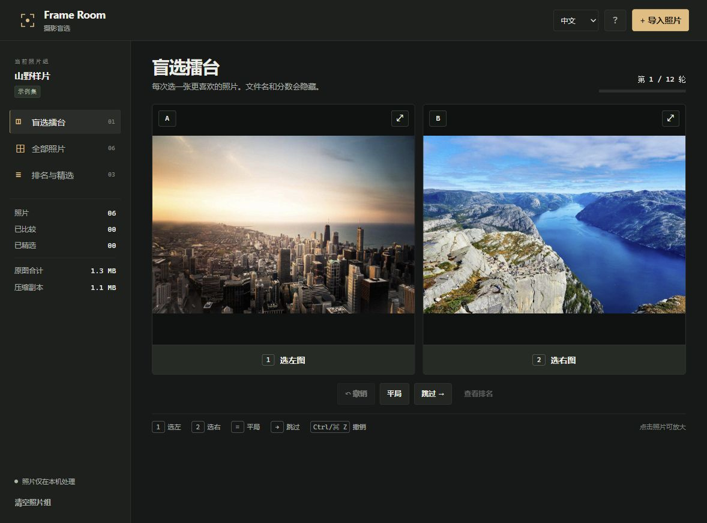

# Frame Room · 摄影盲选

[中文说明](README.zh-CN.md) · **[Open the app](https://derekllr.github.io/frame-room/)**



Frame Room is a browser photo culling tool. Bring in one shoot, compare two anonymous photos at a time, then review the ranking and export your shortlist. The bundled demo lets you try the whole workflow without bringing your own photos.

## Use it

1. **Import** JPG, PNG or WebP files, or drop them onto the page. The first successful import replaces the demo set.
2. **Compare** with `1` / `2`, `=` for a tie, `→` to skip, or `Ctrl/Cmd + Z` to undo. Click a photo to inspect its compressed preview. Names and scores stay hidden during comparisons.
3. **Shortlist** by starring your favorites. Export a ZIP of the JPEG copies, a JPG contact sheet, or a CSV of the full ranking.

The first round has twice as many decisions as photos. You can review early or continue for another round. Scores use Elo (K = 32), with less-seen photos prioritized for the next match. Ranking reflects your decisions in this session; it is sensitive to the order and number of comparisons.

## Large photos and local storage

Imports are processed one at a time. The app reads image headers before decoding, rejects photos above 80 megapixels or 60 MiB, requests a resized bitmap, and re-encodes it as JPEG with a long edge of at most 1600 px. An offscreen worker releases its image buffers after each import. The browser may still need extra memory while decoding a large original, especially on phones.

The app keeps compressed JPEGs and small thumbnails in IndexedDB with a 100-photo / 60 MiB preview budget. Original files never leave your device and are never overwritten. Exports contain the compressed copies. The browser re-encodes pixels, discards capture metadata, and flattens transparency to white. JPEG orientation is read from EXIF. RAW, HEIC and animated images are outside this version's scope. Browser storage can be cleared by the browser or the user; export anything you want to keep.

## Develop

Node.js 20+; no third-party packages.

```sh
npm test
npm run build
npm start
```

Open http://127.0.0.1:4174. Edit `src/`; the build produces the GitHub Pages entry (`index.html`) and a ready-to-host `dist/` folder. Run `node build.mjs --offline` for a self-contained `Frame-Room.html` that includes the demo photos and can be opened directly. Browser storage availability on local files varies. GitHub Pages serves the repository root.

- `src/core.mjs`: header validation, resizing math, matchmaking, Elo.
- `src/image.mjs` / `src/worker.mjs`: one-photo decoding and JPEG encoding.
- `src/zip.mjs`: dependency-free ZIP writer for already-compressed copies.
- `src/app.mjs`: comparison views, local session, selection, exports.
- `tests/core.test.mjs`: image limits, orientation, pairing, ranking and archive checks.

## References and license

The comparison workflow draws on [Squoosh](https://github.com/GoogleChromeLabs/squoosh)'s side-by-side image view. The demo uses [Unsplash](https://unsplash.com/license) photos delivered by [Lorem Picsum](https://picsum.photos/), with individual credits in [demo/credits.json](demo/credits.json) and in the app's Help dialog. The demo photos retain their own license; project code is MIT.
