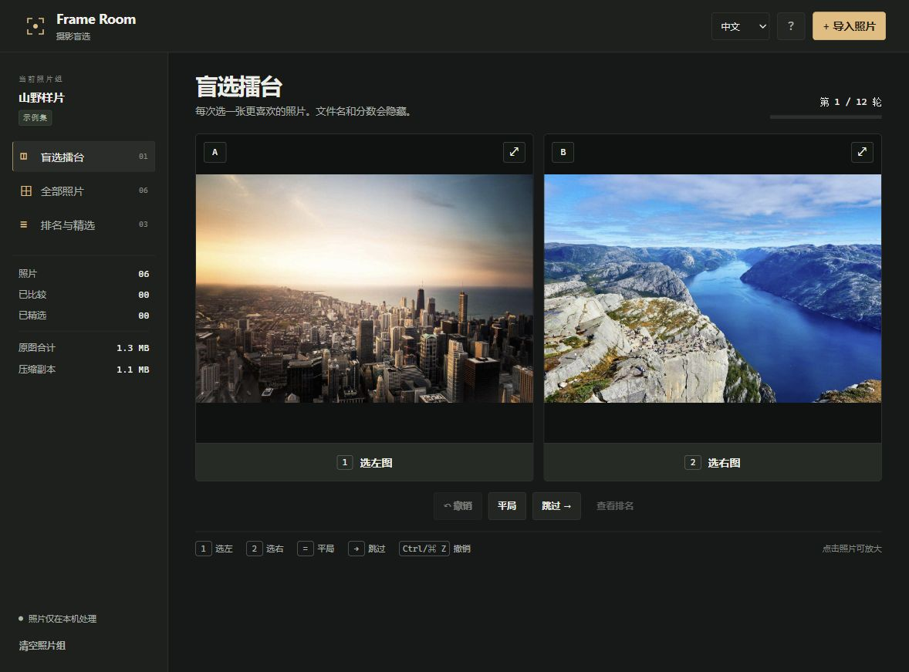

# Frame Room · 摄影盲选

[English](README.md) · **[在线试玩](https://derekllr.github.io/frame-room/)**



拍完一组照片，选不出哪张更喜欢？导入照片，两两盲选，再把想留下的作品打包。页面打开时有一组内置样片，可以先试完整流程。

1. **导入照片**：拖入 JPG、PNG 或 WebP。第一张自己的照片导入成功后，会替换示例集。
2. **两两比较**：按 `1` 选左图、`2` 选右图、`=` 选平局，`→` 跳过，`Ctrl/Cmd + Z` 撤销。点击照片可放大。盲选时不显示文件名和分数。
3. **查看排名与精选**：用星标挑出要留下的照片，导出精选 ZIP、联系表 JPG，或整组排名 CSV。

第一轮默认比较次数为照片数的两倍，也可以提前看排名或继续比较。出场次数少的照片优先参与配对，排名使用 Elo 更新，反映你的选择，不是对照片质量的客观评分。

## 大照片如何处理

照片在本机逐张解码、缩小、压缩为 JPEG，预览最长边不超过 1600 像素。压缩副本和缩略图保存在当前浏览器中，原图不会上传或被覆盖。导出使用压缩副本，拍摄元数据会被移除，透明区域会填白。浏览器解码大图时仍会用到额外内存，手机建议分批导入。

支持静态 JPG、PNG、WebP，每张最多 60 MiB / 8000 万像素，每组最多 100 张，副本与缩略图合计最多 60 MiB。RAW、HEIC 请先转换为 JPG。浏览器可能清除本地存储，重要结果请及时导出。

## 本地开发

需要 Node.js 20+，无需安装第三方依赖。

```sh
npm test
npm run build
npm start
```

本地预览：http://127.0.0.1:4174。编辑 `src/` 后重新构建；`dist/` 是可部署的静态目录。运行 `node build.mjs --offline` 可生成带样片的单文件 `Frame-Room.html`，双击即可离线打开。项目代码为 MIT 许可证；样片及作者信息见 [demo/credits.json](demo/credits.json)。
